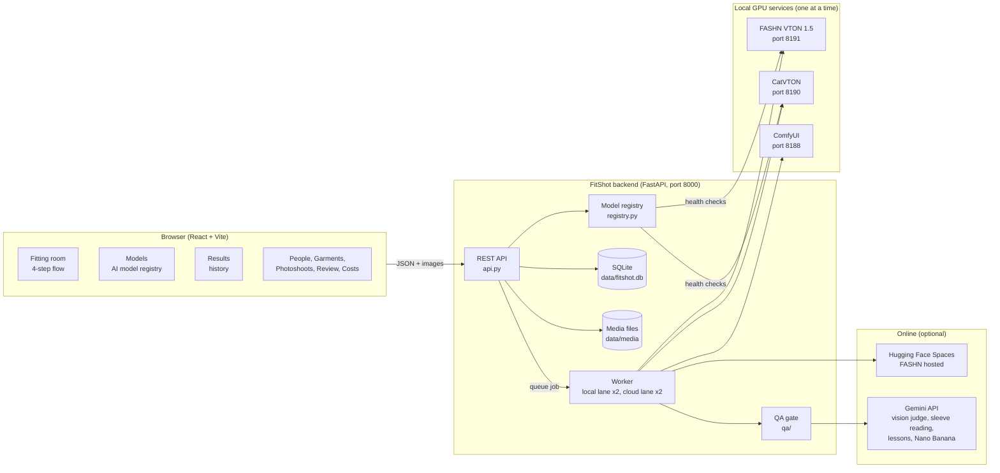
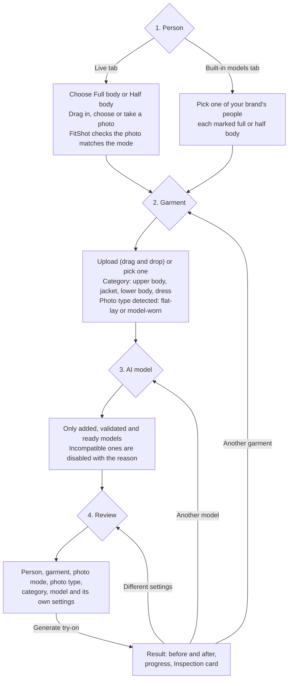
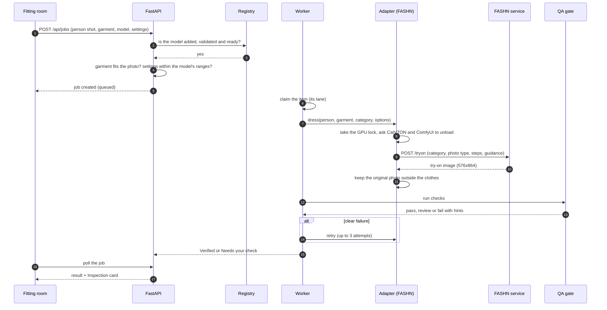
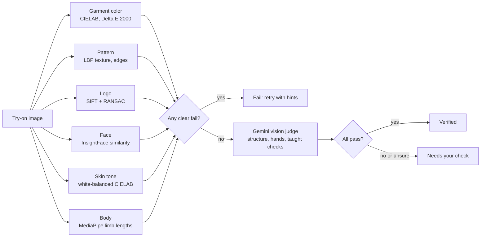
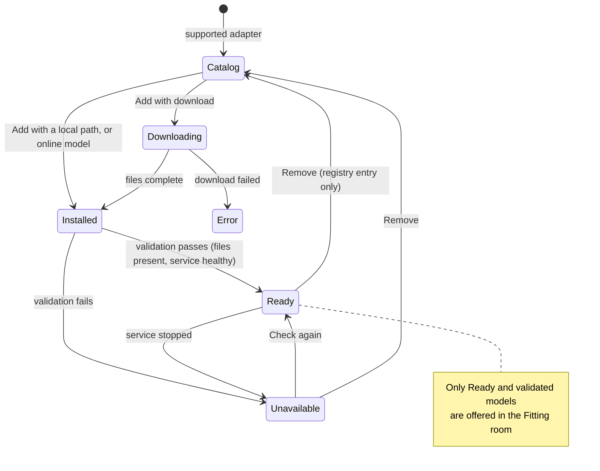
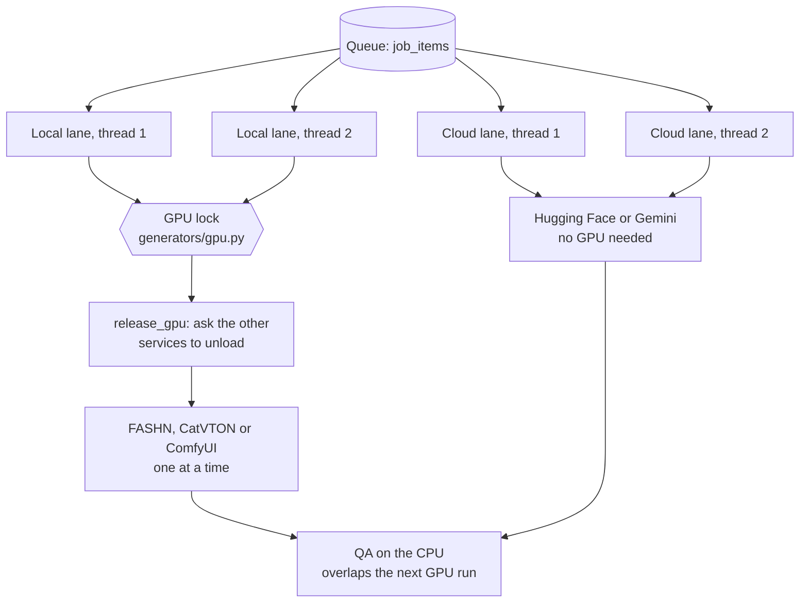
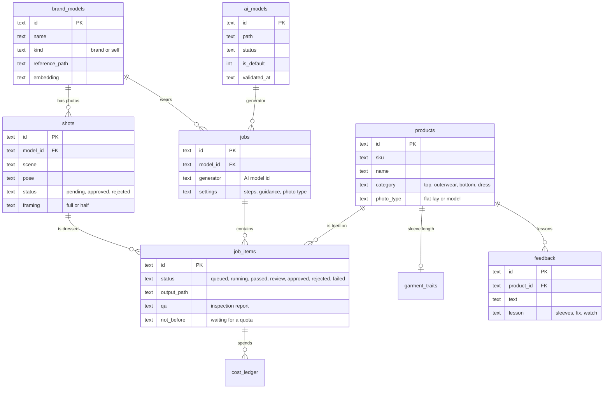
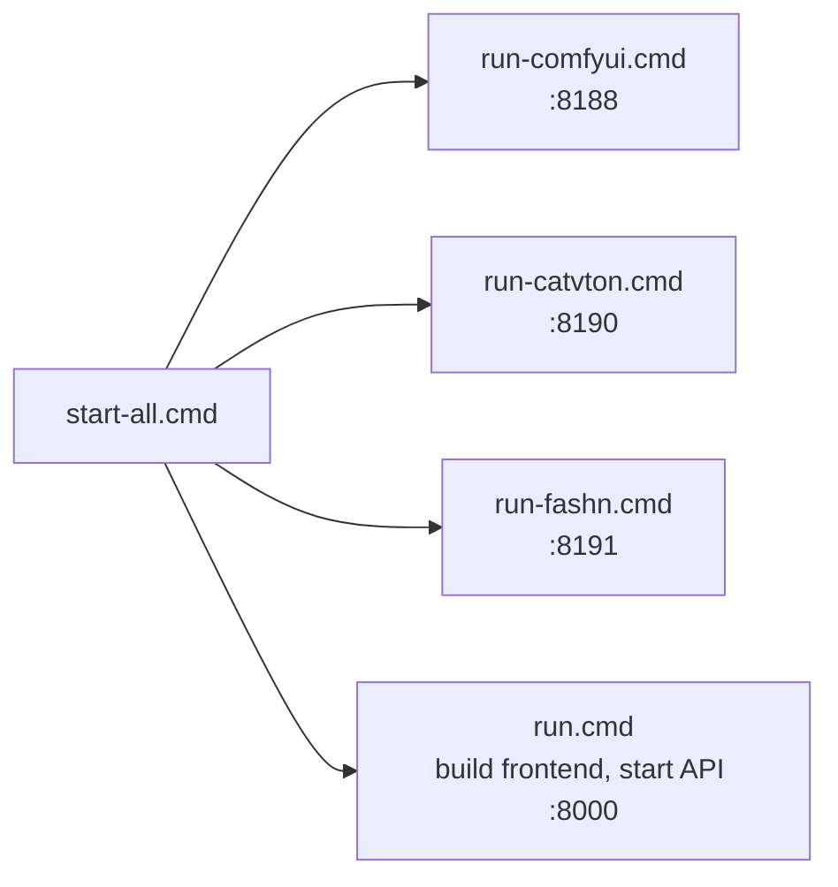

# FitShot

FitShot is a virtual try-on studio for small clothing brands. It puts a garment photo on a person (your own photo or one of your brand's built-in people) with an AI try-on model, then **inspects every result** before it can be published.

Generating try-on images is now a commodity. FitShot focuses on the next question: **is this image safe to publish?** Each photo gets an Inspection card covering the garment, face, body, hands and skin tone. Clear failures are retried, and anything uncertain goes to a person.

- **Fitting room:** a four-step flow: person, garment, AI model, review, then the result with its inspection.
- **Models:** a registry of AI try-on models: add, download, validate, set default, remove.
- **Results:** every try-on, with the model and settings it was made with.
- Runs on a Windows PC with an 8 GB NVIDIA GPU, all free: FASHN VTON 1.5 locally, with CatVTON as a fallback.

---

## Contents

- [System architecture](#system-architecture)
- [The Fitting room flow](#the-fitting-room-flow)
- [How one try-on is made](#how-one-try-on-is-made)
- [Quality inspection](#quality-inspection)
- [AI model registry](#ai-model-registry)
- [Sharing one GPU](#sharing-one-gpu)
- [Data model](#data-model)
- [Repository layout](#repository-layout)
- [API](#api)
- [Run it](#run-it)
- [Configuration](#configuration)
- [Tests and benchmark](#tests-and-benchmark)
- [Teach FitShot](#teach-fitshot)
- [Limitations](#limitations)
- [Licensing](#licensing)

---

## System architecture

FitShot is a React app and a FastAPI backend. The backend never runs a GPU model in its own process: each GPU model runs as its own local service, and the backend coordinates them so only one uses the GPU at a time.



| Part | What it does | Where |
|---|---|---|
| Frontend | Fitting room flow, model management, results, studio tools | `frontend/src` |
| API | Validation, model registry, jobs, people, garments, results | `backend/fitshot/api.py` |
| Model registry | Which AI models are added, validated and ready | `backend/fitshot/registry.py` |
| Worker | Runs queued try-ons in two lanes, retries clear failures | `backend/fitshot/pipeline/worker.py` |
| Adapters | One per AI model; model-specific preprocessing and settings | `backend/fitshot/generators/` |
| QA gate | Garment, face, skin, body, hands and structure checks | `backend/fitshot/qa/` |
| FASHN service | FASHN VTON 1.5 on the GPU, loads once, unloads on request | `services/fashn_server.py` |
| CatVTON service | CatVTON on the GPU | `services/catvton_server.py` |
| ComfyUI | Makes built-in people's photos (InstantID) and CatVTON's bare-arms pass | `comfyui/` (installed by script) |

Three things stay separate everywhere: **AI models** (FASHN, CatVTON), **built-in people** (approved photos of your brand's models) and **live photos** (your own uploads).

---

## The Fitting room flow

The home page. A visible step bar shows where you are. Choices survive going back and reloading the page.



Rules the flow enforces (in the UI and again in the API):

- **Half-body photos wear tops and jackets only.** FitShot never invents body parts the photo does not show, so trousers and dresses need a full-body photo.
- **Full body mode checks the feet are in the photo.** A half-body photo uploaded as "Full body" is refused, with a reason.
- **No silent fallback.** A chosen model that becomes unavailable is reported, never swapped for another.
- **One try-on at a time per press.** Generate is locked while it starts.
- **Background people are ignored.** Small faces and bodies behind you are left out of every check, and their clothes are never edited.

---

## How one try-on is made



Details that matter:

- **The original stays sharp.** FASHN works at 576x864. FitShot pastes its result back only where clothing was or now is, so the face, hands and background keep the photo's full resolution. If FASHN moved the person, its full image is used instead, which avoids ghost edges.
- **Garment photo type.** Model-worn mode cuts the garment out of a person, so a photo with nobody in it always runs as flat-lay.
- **Free quota used up** (FASHN on Hugging Face): the look waits and FitShot retries every hour, rather than failing.

---

## Quality inspection



| Check | Method |
|---|---|
| Garment color | Clothing segmentation, CIELAB palette, Delta E 2000 |
| Pattern | Multi-scale LBP texture and edge density |
| Logo | SIFT matching with RANSAC on a user-marked region |
| Structure and hands | Gemini vision model with structured output, plus checks taught for this garment |
| Identity | InsightFace embedding similarity to the person's reference |
| Skin tone | White-balanced CIELAB comparison with per-scene tolerance |
| Body | MediaPipe limb proportions compared with the person photo |

Without a Gemini key the judge cannot run, so nothing passes automatically: every photo goes to a person. The local checks skip the Gemini call when they already found a clear failure.

---

## AI model registry

The registry is the single source of truth for which try-on models exist. The Fitting room, Results, Photoshoots and People pages all read it, so every page lists the same models under the same names.



| Model | Runs | Garments | Person photos | Garment photos | Notes |
|---|---|---|---|---|---|
| **FASHN VTON 1.5 (this PC)** | Local GPU, about 3 GB, about 60 s | tops, jackets, bottoms, dresses | full, half | flat-lay, model-worn | Default. Apache-2.0. Settings: quality steps (10-50), garment guidance (1-3) |
| **FASHN VTON 1.5 (Hugging Face)** | Online Space | same | full, half | flat-lay, model-worn | Needs `HF_TOKEN`. About 9 images a day on a free account |
| **CatVTON** | Local GPU, up to 7 GB | tops, jackets, bottoms, dresses | full, half | flat-lay | Offline fallback. CC BY-NC-SA 4.0 |
| **Nano Banana** | Gemini API | all | full, half | both | Paid (no free image quota) |
| **Leffa** | - | - | - | - | Listed for a future adapter, cannot be added yet |

Removing a model asks first and warns if it is the default (another model becomes the default). It is refused while a try-on is using the model. It can also delete files that belong to that model alone: never a shared Python environment, ComfyUI or another model's folder. Each adapter keeps its own preprocessing and settings, so a new model (such as Leffa) needs an adapter and a catalog entry, not changes to the Fitting room.

---

## Sharing one GPU

An 8 GB laptop GPU holds one of FASHN, CatVTON or ComfyUI at a time. FitShot enforces that with a single GPU lock, and each local model asks the others to unload before it runs.



- **Two looks in flight:** while one is being checked on the CPU, the next is already on the GPU.
- **Cloud lane:** online models run at the same time as the GPU work.
- **One lock per perception model:** face, pose, hand and clothing models can serve different looks at once.
- `LOCAL_WORKERS` and `CLOUD_WORKERS` set the threads per lane (2 each).

On a 16 GB RAM laptop, memory is tighter than the GPU. If FASHN cannot load because RAM is full, the service says so plainly and the look can be retried. Close the CatVTON window when you do not need it.

---

## Data model

SQLite in `data/fitshot.db`, images under `data/media`. Nothing leaves the PC unless an online model is chosen.



---

## Repository layout

```text
FitShot/
├── backend/                 FastAPI app (uv project)
│   ├── fitshot/
│   │   ├── api.py           REST endpoints and validation
│   │   ├── registry.py      AI model registry: catalog, add, validate, remove
│   │   ├── db.py            SQLite schema and migrations
│   │   ├── learning.py      Notes to lessons (Teach FitShot)
│   │   ├── generators/      One adapter per model + GPU lock
│   │   │   ├── fashn.py     FASHN VTON 1.5, this PC or Hugging Face
│   │   │   ├── catvton.py   CatVTON with its mask and bare-arms pass
│   │   │   ├── comfyui.py   Person photos (InstantID) and masks
│   │   │   ├── nano_banana.py
│   │   │   └── gpu.py       GPU lock and release_gpu
│   │   ├── pipeline/        Worker lanes, retries, face restore
│   │   └── qa/              Perception, garment, body checks, Gemini judge
│   └── tests/               pytest suite
├── frontend/                React 18 + Vite + TypeScript
│   └── src/
│       ├── pages/           FittingRoom, AiModels, Results, Models (People),
│       │                    Garments, Shoots, Review, Costs
│       ├── Upload.tsx       Drag-and-drop upload with camera
│       ├── Camera.tsx       Live camera with framing guides
│       ├── Slip.tsx         The Inspection card
│       ├── flow.ts          Fitting room state, kept across reloads
│       └── api.ts           Typed API client
├── services/                FASHN and CatVTON GPU services
├── scripts/                 One-time setup for ComfyUI, CatVTON, FASHN
├── benchmark/               FASHN vs CatVTON on the same synthetic inputs
├── samples/                 Synthetic sample garments and a reference face
├── run.cmd, start-all.cmd   Launchers (Windows)
├── DEPLOY.md                Vercel frontend + this PC as the backend
└── DESIGN.md, PRODUCT.md    Design system and product context
```

---

## API

| Area | Endpoints |
|---|---|
| Status | `GET /api/status` |
| AI models | `GET /api/ai-models` · `POST /api/ai-models` · `POST /api/ai-models/{id}/validate` · `POST /api/ai-models/{id}/default` · `GET /api/ai-models/{id}/files` · `DELETE /api/ai-models/{id}?delete_files=` |
| People | `GET /api/people` (built-in) · `GET /api/live-photos` · `POST /api/selfies` (photo, mode full/half, consent) · `GET/POST /api/models` · `POST /api/models/{id}/shots` · `POST /api/models/{id}/shots/upload` · `PATCH /api/shots/{id}` · `DELETE /api/models/{id}` (own photos) |
| Garments | `GET /api/products` · `POST /api/products` · `GET /api/products/{id}/lessons` |
| Try-ons | `POST /api/jobs` (with `settings`) · `POST /api/jobs/bulk` (CSV + ZIP) · `GET /api/jobs` · `GET /api/jobs/{id}` · `GET /api/results` · `GET /api/looks` |
| Decisions | `GET /api/review` · `POST /api/items/{id}/review` · `/reopen` · `/retry` · `/feedback` · `DELETE /api/items/{id}` · `DELETE /api/lessons/{id}` |
| Export and cost | `GET /api/jobs/{id}/export` · `GET /api/costs` |

---

## Run it

Requires Windows, an NVIDIA GPU (8 GB tested), Python 3.12 with [uv](https://docs.astral.sh/uv/), Node 20 or newer and Git Bash.

**1. Backend and frontend**

```powershell
cd backend
uv sync
cd ..
copy .env.example .env   # add GEMINI_API_KEY for the vision checks
```

**2. Models (one time, from Git Bash)**

```bash
bash scripts/setup_comfyui.sh    # ComfyUI for person photos, about 14 GB
bash scripts/setup_catvton.sh    # CatVTON, about 6 GB with its Python environment
bash scripts/setup_fashn.sh      # FASHN VTON 1.5, about 2.6 GB, reuses CatVTON's environment
```

The QA models (InsightFace, MediaPipe, clothing segmentation) go in `models/`.

**3. Start everything**

Double-click `start-all.cmd`. It opens ComfyUI, CatVTON and FASHN in their own windows, builds the frontend and starts FitShot at <http://127.0.0.1:8000>. Keep the windows open while you use it. To run only the app, use `run.cmd`.



To put the app online with Vercel while the GPU work stays on this PC, see [DEPLOY.md](DEPLOY.md).

---

## Configuration

Settings come from `.env` (see `.env.example`). Keys are never committed.

| Variable | Purpose |
|---|---|
| `GEMINI_API_KEY` | Vision judge, sleeve reading, lessons, Nano Banana |
| `HF_TOKEN` | FASHN on Hugging Face (a free Read token) |
| `FASHN_SPACES` | Hugging Face Spaces to try, in order |
| `FASHN_STEPS` | Default quality steps for FASHN (30) |
| `LOCAL_WORKERS`, `CLOUD_WORKERS` | Worker threads per lane (2 each) |
| `FITSHOT_ACCESS_KEY`, `FITSHOT_CORS_ORIGINS` | Only when the backend is reachable from the internet |
| `DATA_DIR` | Where the database and images live (default `data/`) |

---

## Tests and benchmark

```powershell
cd backend
uv run pytest
```

The suite covers:
- the API and the registry (add, validate, default, remove, busy and default protection, exclusive-files-only deletion);
- the Fitting room rules (full and half body, garment fit, settings ranges, results history);
- FASHN routing (this PC vs Hugging Face, no fallback, quota waiting, the flat-lay safeguard);
- the QA gate and background-person handling.

The tests never call the network.

[benchmark/](benchmark/) runs the same synthetic people and garments through FASHN and CatVTON and writes a report and a contact sheet. FASHN was clearly better on 5 of 7 scenarios, including the dress CatVTON broke; the trousers were a tie. Results and method are in [benchmark/results/REPORT.md](benchmark/results/REPORT.md).

---

## Teach FitShot

On any Inspection card, press **Tell FitShot what's wrong** and write the problem in your own words, in any language. Gemini turns the note into a lesson for that garment:
- a corrected **sleeve length**;
- a **fix** for generators that read prompts;
- a **check** the vision inspector makes on every later photo of that garment.

Every lesson is listed with **Forget this**.

---

## Limitations

- QA thresholds are provisional and not yet calibrated on a labeled set.
- Without a Gemini key, the hand and structure checks cannot run, so every photo goes to human review.
- FitShot shows how a garment looks. It does not predict real size or fit.
- FASHN can leave traces of a bulky top (a hoodie's sleeves) under a slim one, and can draw a jacket open with nothing underneath. The inspection usually flags it; Retry draws a new attempt.
- The camera opens only on a secure address: `http://127.0.0.1` here, or the https Vercel address.
- Built-in people in this repository are synthetic (generated locally); add your own with consent.

---

## Licensing

- **FASHN VTON 1.5** is Apache-2.0. The community Spaces that host it are run by other people.
- **Non-commercial terms:** InsightFace's pretrained models, the InstantID pipeline that depends on them, and CatVTON (CC BY-NC-SA 4.0).

Replace or license the non-commercial models before commercial use, and check each model's licence for your use case.
